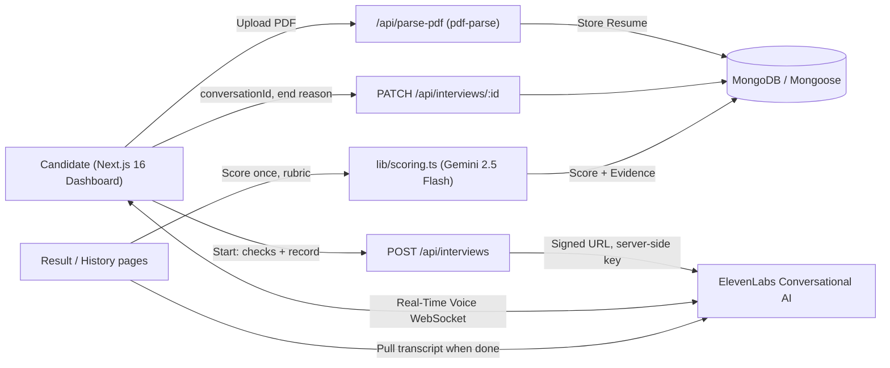

# SWE Interview — AI Voice Mock Interview Platform


**SWE Interview** is a full-stack AI voice mock interview platform for software engineers. Candidates upload their PDF resumes, configure their target role and seniority level, conduct real-time two-way voice interviews powered by **ElevenLabs Conversational AI**, and receive automated structured evaluations (1–10 score + actionable feedback) from **Google Gemini 2.5 Flash**.

---

## Architecture



---

## Key Features

- **Real-Time AI Voice Interviewer:** Two-way low-latency voice conversations using `@elevenlabs/react` and `@elevenlabs/elevenlabs-js` with server-generated signed WebSocket URLs so API keys never leak to the browser.
- **Resume-Aware Personalization:** Uploads and extracts raw text from candidate PDF resumes (`pdf-parse`) and pairs it with profile metadata (`targetRole`, `experienceLevel`) so the voice agent asks tailored technical questions.
- **Automated Structured Evaluation:** Fetches the full interview transcript from ElevenLabs and evaluates it with **Gemini 2.5 Flash** (`responseMimeType: "application/json"`) to generate a 1–10 score, strengths, improvement areas, and communication feedback.
- **Interview History & Profile Dashboard:** Track past mock interviews, revisit full transcripts and scorecards, and manage multiple uploaded resumes.
- **Secure Auth & Validation:** JWT HTTP-only cookies, `bcryptjs` password hashing, and `zod` request validation backed by MongoDB (Mongoose).
- **Docker & CI/CD Ready:** Multi-stage production `Dockerfile` and GitHub Actions CI pipeline (TypeScript typecheck, Next.js production build, Docker image build).

---

## Tech Stack

| Layer | Technology |
| :--- | :--- |
| **Framework** | Next.js 16 (App Router), React 19, TypeScript 5, Tailwind CSS v4 |
| **Voice AI Agent** | ElevenLabs Conversational AI (`@elevenlabs/react`, `@elevenlabs/elevenlabs-js`) |
| **LLM Evaluation** | Google Gemini 2.5 Flash (`@google/genai`, structured JSON output) |
| **Resume Processing** | `pdf-parse` |
| **Database & Auth** | MongoDB, Mongoose 9, JWT, `bcryptjs`, Zod v4 |
| **DevOps** | Docker, GitHub Actions CI |

---

## Getting Started

### Prerequisites

- Node.js 20+
- MongoDB database (Atlas or local)
- ElevenLabs API key + Conversational AI Agent ID
- Google Gemini API key

### 1. Clone & Install

```bash
git clone https://github.com/M-U-Rony/swe-interview.git
cd swe-interview
npm install --legacy-peer-deps
```

### 2. Configure Environment Variables

```bash
cp .env.example .env.local
```

Fill in `.env.local`:

```env
MONGODB_URL="mongodb://localhost:27017/swe-interview"
JWT_SECRET="at-least-32-characters"   # openssl rand -base64 32
ELEVENLABS_API_KEY="your-elevenlabs-api-key"
ELEVENLABS_AGENT_ID="your-elevenlabs-agent-id"
GEMINI_API_KEY="your-gemini-api-key"
```

### 3. Set Up the Interviewer Agent

Run once (and again whenever `prompts/interviewer.md` changes). It configures the ElevenLabs agent: Marcus's prompt, 15-minute limit, silence handling, English only, and blocks the browser from overriding the prompt.

```bash
npm run setup:agent
```

### 4. Run Development Server

```bash
npm run dev
```

Open [http://localhost:3000](http://localhost:3000).

---

## Docker Deployment

```bash
docker build -t swe-interview .
docker run -d -p 3000:3000 --name swe-interview-app --env-file .env.local swe-interview
```

---

## Project Structure

```text
├── .github/workflows/ci.yml        # GitHub Actions CI (typecheck, Next.js build, Docker build)
├── app/
│   ├── api/
│   │   ├── interviews/             # Start, track and retry-scoring interviews
│   │   ├── parse-pdf/              # PDF resume upload & text extraction
│   │   └── signup / signin / me / profile / signout
│   └── dashboard/
│       ├── interview/              # Voice interview setup, live session & results
│       ├── history/                # Past interviews & scorecards
│       ├── resumes/                # Resume library
│       └── profile/                # Target role & seniority profile
├── components/
│   ├── conversation.tsx            # ElevenLabs real-time voice conversation client
│   └── interviewClient.tsx         # Interview flow orchestrator
├── lib/
│   ├── auth.ts                     # JWT session helpers
│   ├── env.ts                      # Validated server environment
│   ├── interviews.ts               # Interview lifecycle, limits, reconciliation
│   ├── scoring.ts                  # Rubric scoring with Gemini
│   ├── elevenlabs.ts               # ElevenLabs REST calls
│   └── resume.ts                   # Resume cleaning and checks
├── prompts/interviewer.md          # Marcus's system prompt (pushed by setup:agent)
├── scripts/setup-agent.mts         # One-time ElevenLabs agent setup
├── models/model.ts                 # Mongoose schemas (User, Resume, Profile, Interview)
├── utils/
│   ├── dbConnection.ts             # MongoDB singleton connection
│   └── zodSchemas.ts               # Zod validation schemas
└── Dockerfile
```

---

## License

This project is open-source and available under the [MIT License](LICENSE).
